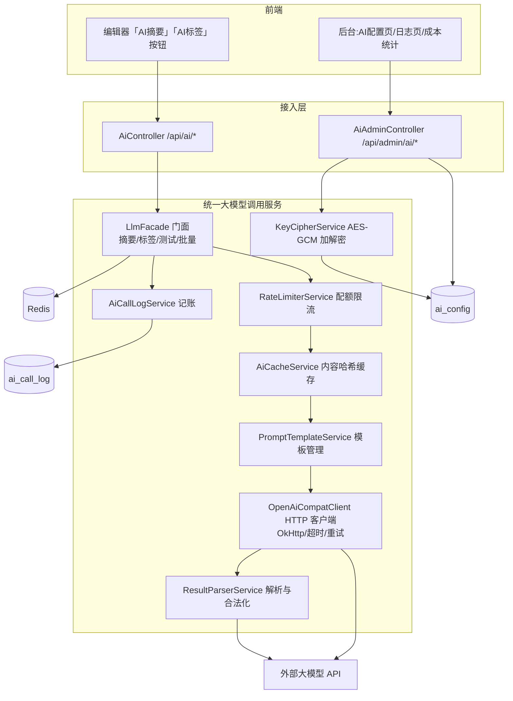

# AI 模块设计（个人博客系统）★ 设计重点

> 课题核心：管理员统一配置 API → 后端调用大模型 → 用户使用 AI 功能
> 关联表：`ai_config`、`ai_call_log`、`sys_config`；关联接口见《API接口设计.md》§7；主流程时序见《系统设计.md》§3.3 ｜ v1.0 ｜ 2026-09-12

## 1. 设计目标与总体结构

### 1.1 要解决的四类问题

| 问题 | 朴素做法的缺陷 | 本模块方案 |
|------|----------------|------------|
| Key 管理 | 把 Key 配在前端 `.env` 或用户各自持有——泄露即被盗刷 | 管理员一次配置 → AES-256-GCM 密文入库 → 仅后端解密使用，前台接口结构上不存在 Key 字段 |
| 厂商差异 | 直连某厂商 SDK，换模型改代码 | 统一 OpenAI 兼容协议 `LlmClient`，`ai_config` 表热切换 Base URL/模型 |
| 成本与滥用 | 每次点击都真调 API | 内容哈希结果缓存 + 用户日配额限流 + max_tokens 闸门 + 全量调用记账 |
| 稳定性 | 大模型抖动拖垮发文主流程 | 独立线程池 + 超时 + 有限重试 + 降级返回业务码（AI 永远"建议"，不阻塞保存） |

### 1.2 组件结构



## 2. 管理员配置 API：数据模型与管理流程

### 2.1 数据模型（表 `ai_config`，字段详见《数据库设计.md》§3.11）

关键字段语义：
- `api_key_cipher VARCHAR(500)`：AES-256-GCM 密文，Base64（编码后长度 = 24B(IV) + 密文 + 16B(Tag)，500 足够容纳 256 字符 Key）。
- `api_key_mask VARCHAR(30)`：入库时由后端计算——保留前 3 字符 + `****` + 后 4 字符，**列表页唯一展示形态**。
- `is_default`：全站默认配置；用户端 AI 请求固定路由到默认配置（本期不做按用户/按业务的配置选择，接口预留 `configId` 参数）。
- `temperature / max_tokens / timeout_ms`：成本与质量的调参闸门，管理员可调，无需改代码。
- `summary_prompt / tag_prompt`：可选覆盖内置模板（NULL 用内置），支持不改代码灰度新提示词。

### 2.2 配置管理流程（后台）

1. 管理员进入「系统设置 → AI 服务」，`POST /api/admin/ai/configs` 提交 `{name, provider, baseUrl, apiKey, model, temperature, maxTokens, timeoutMs, isDefault}`。
2. `KeyCipherService.encrypt()`：
   - 主密钥 `blog.ai.master-key` **只存在于环境变量/启动参数**（`.env` 与 git 隔离，docker-compose 注入），长度 32 字节，生产用 `openssl rand -hex 32` 生成。
   - 每次加密生成随机 12 字节 IV（GCM 推荐），`cipher = Base64(IV || ciphertext || tag)`。
   - 同文不同密文（随机 IV）→ 拖库也无法做密文比对推断 Key 复用。
   - 计算掩码后**丢弃明文**（不落日志、不进异常栈——全局异常处理器对含 `apiKey` 字段的 DTO 做脱敏 toString）。
3. 保存后点「连接测试」→ `POST /api/admin/ai/configs/{id}/test`：以 `messages=[{"role":"user","content":"请仅回复OK"}]、max_tokens=8` 发起一次最小成本调用；按上游状态码映射：401→`4101 Key 无效`、网络超时→`4102 Base URL 不可达`、200→ok。测试结果同样写 `ai_call_log(biz_type=CONNECT_TEST)`。
4. 「设为默认」`PATCH /configs/{id}/default`：`@Transactional` 内先 `UPDATE ai_config SET is_default=0`，再置本行为 1，保证唯一默认。
5. 启停/删除：`enabled=0` 的用户端请求返回 `4001`；删除为"停用保留行"，不物理删（审计链 `ai_call_log.ai_config_id` 不断）。
6. 修改 Key 走 `PUT /configs/{id}`：`apiKey` 传空串/缺省=保持原密文不变；传新值=重新加密覆盖——**任何读接口永不回传 Key**。

### 2.3 配置缓存与热更新

`ai_config` 默认配置行缓存于 Redis `sys:config` 镜像与本地 Caffeine（60s TTL）：调用路径少查一次库；修改配置后主动 `DEL` 缓存（Cache-Aside）。配置表数据量恒小（<50 行），全量缓存安全。

## 3. 后端统一大模型调用服务 `LlmService`

### 3.1 对外门面（业务语义 API）

```java
public interface LlmFacade {
    SummaryResult generateSummary(Long userId, SummaryCmd cmd);   // 摘要
    TagsResult    generateTags(Long userId, TagsCmd cmd);         // 标签
    TestResult    testConnection(Long configId);                  // 管理员连通测试
    void          batchEnrich(List<Long> articleIds);             // 批量补全(ADMIN, 异步)
}
```

内部调用链（管道模式，每步可单测）：

```
鉴权与开关 → 限流(Redis) → 缓存查找 → 异步提交线程池 → 取配置+解密Key
→ 装配提示词 → HTTP 调用(超时/重试) → 解析校验 → 结果缓存 → 记账日志 → 返回
```

### 3.2 HTTP 客户端 `OpenAiCompatClient`

统一走 OpenAI 兼容 `POST {baseUrl}/chat/completions`：

```json
{ "model": "deepseek-chat",
  "messages": [ {"role":"system","content":"<模板 system 段>"},
                {"role":"user","content":"<标题 + 归一化正文>"} ],
  "temperature": 0.3, "max_tokens": 300, "stream": false }
```

- 客户端：OkHttp 4（连接池 16），`connectTimeout=5s`，`readTimeout=ai_config.timeout_ms(默认30s)`。
- 请求头 `Authorization: Bearer <解密后的Key>`——仅在发起 HTTP 的瞬间以参数传入，不出现在任何 DTO/日志。
- 响应统一解析 `choices[0].message.content` 与 `usage.{prompt_tokens, completion_tokens}`。
- 适配性说明：DeepSeek（`https://api.deepseek.com/v1`）、通义千问兼容模式（`https://dashscope.aliyuncs.com/compatible-mode/v1`）、Kimi（`https://api.moonshot.cn/v1`）、OpenAI 官方——仅 Base URL/模型名不同，零代码切换，答辩现场可演示换模型。

### 3.3 超时与重试策略

| 项 | 规则 |
|----|------|
| 单次超时 | 30s（可配）；整体 DeferredResult 超时 35s > 单次超时×(重试次数) 的兜底 |
| 可重试错误 | 连接超时、读超时、HTTP 429、5xx |
| 不可重试错误 | 401/403（Key 错）、400（请求体非法）、404（模型名错）——立即失败并给出针对性错误码 |
| 重试次数 | ≤2 次，指数退避 1s→2s + 随机抖动（防与限流窗口对敲） |
| 熔断（P2） | 滑动窗口失败率 >50% 时短路 60s，直接降级 `4002`，保护配额与线程池 |

### 3.4 限流与配额

- 用户维度：`INCR ai:quota:{uid}:{yyyyMMdd}`，首次设置 TTL 至当日 24:00；> `sys_config.ai_daily_quota`（默认 50）→ `429/4003`。缓存命中同样计数（防"刷缓存探测"以外的滥用成本为零，可只计真实调用，设计取**只计真实发起的调用**，代码注释说明）。
- 全局维度（P2）：`INCR ai:quota:global:{yyyyMMdd}` 全站日预算阈值，超限后台页红色告警 + 可一键 `ai_enabled=false` 熔断。
- 并发维度：线程池队列上限 100，拒绝策略 `AbortPolicy` → 快速失败 `4002`，不无限堆积拖垮内存。

### 3.5 异常降级矩阵

| 异常 | 用户可见行为 | 系统行为 |
|------|--------------|----------|
| 超时/网络失败（重试耗尽） | toast「AI 服务暂不可用，请稍后重试或手动填写」(4002) | 记日志 status=2，error_msg 截断 |
| Key 失效/模型名错 | 用户端 4002；管理端 test 给出精确 4101 | 日志 + 连续 5 次同类失败站内提示管理员检查配置 |
| 未配置默认 | 4001 + 按钮灰置提示 | `/api/ai/status.configured=false` |
| 功能被关 | 4004 | 读 sys_config |
| 返回不可解析 | 4005 建议重试 | 原文存日志备查（≤500 字符） |
| AI 完全不可用 | **文章保存/发布不受任何影响** | AI 为旁路增强，不在发文事务内 |

## 4. 提示词模板管理

模板三级加载优先级：`ai_config.summary_prompt（管理员自定义）` > 数据库 `ai_prompt_template` 表版本（P2）> **代码内置枚举 `PromptTemplate`**（带版本号常量）。版本号参与缓存键（§6），改模板即自动失效旧缓存，避免"改了提示词但一直吐旧结果"的经典 bug。

```java
public enum PromptTemplate {
    SUMMARY("ai_summary_v1"), TAGS("ai_tag_v1");
    public final String version;   // 缓存键组成部分
    String render(String title, String text) { ... }
}
```

## 5. AI 摘要与 AI 标签的提示词设计与输出约定 ★

### 5.1 摘要生成（`ai_summary_v1`）

**System 段：**

```text
你是一名中文技术博客编辑。你的任务是把用户提供的博客文章正文压缩成一段摘要。
硬性要求：
1) 摘要长度 80~150 字（中文字符计），最多 2 句；
2) 忠实原文，禁止编造原文没有的信息、观点、数据；
3) 不要出现"本文介绍了一种方法"以外的元话语堆砌，不使用 Markdown 标记；
4) 结尾不加句号以外的标点；
5) 只输出摘要文本本身，不要任何前后缀、引号、编号、解释。
若原文为英文，输出中文摘要。
```

**User 段（变量注入）：**

```text
【文章标题】{{title}}
【文章正文】
{{content}}
```

- 输入预处理：Markdown → 纯文本（剥代码块围栏保留语言标记可选、去图片链接语法、折叠空白）；**截断策略**：标题+首 4000 字+尾 1000 字（长文首尾信息密度高，控 Token 成本）。
- 输出校验：非空；80 ≤ 长度 ≤ 200（超限不拒绝，截断至 197+"…"）；含 Markdown/换行则清洗；命中敏感词表则整体拒绝返回 4005。
- 失败兜底：模型不守规矩时取**正文前 120 字 + 省略号**作为机械摘要直接返回（仍算成功，标记 `fallback:true`），答辩可演示。

### 5.2 标签生成（`ai_tag_v1`，强约束 JSON 数组）

**System 段：**

```text
你是一名中文博客的标签管理员。根据文章内容提炼标签。
规则：
1) 输出 3~6 个标签，每个 2~8 个字；
2) 标签覆盖：主题领域、技术栈/实体、内容类型三个维度，避免同义重复（如"Java"与"java编程"）；
3) 禁止输出标点、空格、emoji、停用词（"分享""总结""笔记"单独不成标签）；
4) 必须且只能输出一个 JSON 数组，形如 ["SpringBoot","缓存","Redis"]，
   不要输出 Markdown 代码块标记、不要任何解释文字。
```

**User 段：** 同摘要（标题 + 归一化正文，截断策略一致）。

**输出解析（防御式三级）：**

```java
String raw = stripCodeFence(content);        // 容错①: 剥掉 ```json ... ``` 围栏
List<String> tags = tryParseJsonArray(raw);  // 容错②: JSONUtil.parseArray
if (tags == null) tags = trySplitLoose(raw); // 容错③: 退化为按 ,，、换行 切分
// 合法化过滤: trim/去重(忽略大小写)/长度2~8/黑名单词/敏感词/最多保留6个
```

`ResultParserService.tags()` 返回 `List<String>` 后才进 §6 缓存；全部解析失败 → `4005` 提示重试。
**入库时机**：AI 结果仅回显给用户勾选，随 `POST /api/articles` 保存时由文章模块统一 `tag` upsert + `article_tag` 重建——AI 模块自身**不写业务表**。

### 5.3 提示词迭代规范

每次调模板：改 `version` 常量（v1→v2）→ 本地 20 篇标注样本人工评测摘要质量/标签准确率 → 记录于论文实验章节。管理员自定义模板同样带版本号（修改 `updated_at` 参与缓存键）。

## 6. 成本控制与缓存策略

### 6.1 内容归一化哈希（"相同内容不重复调用"的实现）

```java
String normalized = contentMd.replaceAll("\\s+","")
    .replaceAll("!\\[[^]]*]\\([^)]*\\)","")   // 去图片(不影响主题)
    .toLowerCase();
String hash = sha256Hex(title + "\n" + normalized);   // CHAR(64)
```

缓存键：

```
ai:{bizType}:{hash}:{model}:{promptVer}:{temp}   // 如 ai:summary:ab12...:deepseek-chat:ai_summary_v1:0.30
```

维度设计理由：换模型、换提示词版本、改温度都会自然绕开旧缓存（结果不可比）；内容任何实质改动改变哈希。

### 6.2 缓存读写路径

- 命中：直接返回 + `fromCache:true` + 写 `ai_call_log(cache_hit=1, latency≈2ms, cost=0)`；**不计入用户配额**、不发真实调用。
- 未命中：真实调用成功后 `SETEX` 7 天；失败不写缓存（下次可重试）。
- 摘要与标签共享同一次"正文归一化哈希"计算；前端两按钮并发点击时，两调用相互独立（本期不做 single-flight 合并，列为 P2 演进项——同文首次同时点击会付两次钱，概率低且金额 <0.01 元，在论文中作为权衡说明）。

### 6.3 成本闸门与记账

| 闸门 | 手段 |
|------|------|
| 输入侧 | 正文截断（摘要/标签各 ≤~6000 字）→ prompt tokens 上限可控 |
| 输出侧 | `max_tokens`（摘要 300 / 标签 128，ai_config 可调） |
| 频次侧 | 用户日配额 50（sys_config）+ 全局日预算（P2 熔断） |
| 定价侧 | sys_config 配 `ai_price_per_1k_prompt/completion`（元），日志表 `cost_est` 实时估算 |

账单查询：`GET /api/admin/ai/stats` 按日/按 biz_type/按用户聚合 `SUM(cost_est)`、`SUM(cache_hit)/COUNT(*)` 命中率——答辩演示"AI 成本可视化"（Cache 命中率目标 ≥30%：同一用户反复点"重新生成"被限配额约束，草稿多轮微调正文变化不命中属预期）。

## 7. 异步处理方案

**选型决策：线程池 + DeferredResult（WebMVC 异步），而非 MQ。**

```java
@Bean("aiExecutor") new ThreadPoolTaskExecutor(
  core=8, max=16, queue=100, keepAlive=60s,
  threadNamePrefix="ai-", RejectedHandler=AbortPolicy)   // 拒绝→快速降级4002
```

理由：
1. 语义是"请求-响应"（用户在编辑器里等结果回填），MQ 的异步消费反而需要额外的轮询/WS 回执通道，复杂度净增。
2. `DeferredResult` 把等待从 Tomcat 线程（200 默认）卸载到专用 `ai-*` 线程——30s 级慢调用不会占满 Web 线程饿死文章/评论接口。
3. 超时链：客户端 Axios 40s > DeferredResult 35s > 单次 HTTP 30s；任一环节超时都收敛为 `4002` 业务码。
4. 演进预案：`batchEnrich`（批量为历史文章补摘要/标签）已用 `@Async("aiExecutor")` + 逐条限速（每批间隔 500ms）模拟离线队列；若日后接入真 MQ，仅需替换 `LlmFacade.batchEnrich` 的实现投递 `ai-task` 队列，门面不变。

## 8. 安全与隐私考虑

| 维度 | 措施 |
|------|------|
| Key 保密 | AES-256-GCM 密文入库；主密钥环境变量分离；读接口 DTO 无 Key 字段（编译期杜绝回传）；异常处理器对 `apiKey/password` 字段脱敏 |
| 内容隐私 | 调用前明示"文章内容将发送至第三方模型服务"；`ai_config.baseUrl` 仅 ADMIN 可改且变更记入 `sys_config` 审计；不把用户邮箱/昵称注入 prompt（只注入标题+正文） |
| Prompt 注入 | 用户内容作为**数据**放入 user 段，system 段固化角色与输出契约；对输出二次校验（长度/词表/JSON schema），注入最多污染一次建议结果，永远进不了数据库（保存需用户确认） |
| 滥用防护 | 未登录不可调用；日配额 + 线程池上限 + 缓存去重 + 总开关一键熔断 |
| 审计 | 全量 `ai_call_log`（含 content_hash，可回溯"谁用哪个模型生成过什么内容"），日志只插不改 |
| 合规 | 前端展示 AI 生成标识（`summary_source=1` 时详情页显示"摘要由 AI 生成"角标） |
| 传输 | 生产全站 HTTPS（Nginx TLS 终结），后端→大模型走厂商 TLS |

## 9. 关键类一览（落地映射）

```
com.blog.module.ai
├── controller/  AiController, AiAdminController
├── service/     LlmFacade(impl AiFacadeImpl), AiConfigService, AiCacheService,
│                AiQuotaService, AiCallLogService, PromptTemplateService, ResultParserService
├── client/      LlmClient(接口) / OpenAiCompatClient(impl), LlmRequest, LlmResponse
├── crypto/      AesGcmUtil, KeyMaskUtil
├── config/      AiAsyncConfig(ThreadPool), AiProperties
├── entity/      AiConfig, AiCallLog   |  mapper/ 对应 MP Mapper
└── dto/         SummaryCmd/Result, TagsCmd/Result, AiConfigSaveDto(含明文入参),
                 AiConfigVo(仅掩码)    |  enums/ BizType, PromptTemplate, LlmBizCode
```

## 10. 答辩演示脚本（建议）

1. 后台新增 AI 配置（现场填 Key→列表只显示 `sk-****xxxx`）→ 点「连接测试」绿勾。
2. 前台编辑器粘贴一篇长文 → 点「AI 生成摘要」，5 秒内回填 → 看后台日志 `SUCCESS, tokens, cost_est`。
3. 同文再点一次 → `fromCache:true`，日志 `cache_hit=1`、耗时 2ms、成本 0。
4. 点「AI 生成标签」→ 返回 JSON 数组勾选入库 → 标签云出现新标签。
5. 把 `ai_config` 停用 → 前台按钮灰置提示未配置；把 Key 改错 → 演示降级 4002 且文章仍可正常保存。
6. 改 `temperature`/换模型 → 缓存自动绕过（键含模型名），体现设计一致性。
