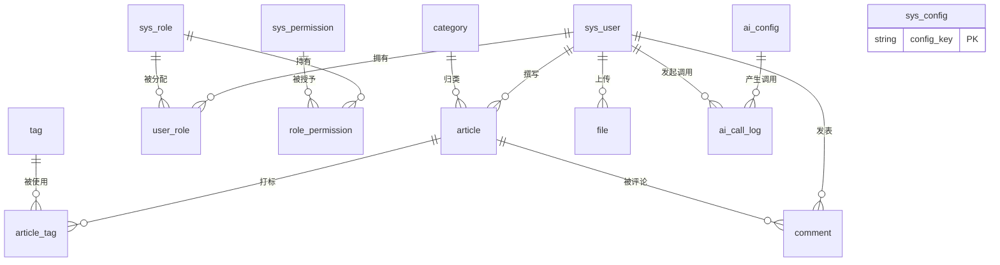

# 数据库设计（个人博客系统）

> 项目：个人博客系统 ｜ MySQL 8.0 ｜ utf8mb4 / InnoDB ｜ v1.0 ｜ 2026-09-12

## 1. 设计约定

1. 所有表使用 `utf8mb4` + `utf8mb4_0900_ai_ci`，支持中文与 emoji（Markdown 正文常见）。
2. 主键统一 `id BIGINT UNSIGNED AUTO_INCREMENT`；MyBatis-Plus 默认雪花策略可切换为数据库自增（本设计用自增，便于课设演示阅读）。
3. 公共审计字段：`created_at`（默认 CURRENT_TIMESTAMP）、`updated_at`（ON UPDATE CURRENT_TIMESTAMP）、`deleted`（0 未删 / 1 已删，逻辑删除，MyBatis-Plus `@TableLogic`）。
4. 布尔字段用 `TINYINT(1)` + `COMMENT '0否1是'`；状态用 `TINYINT` 枚举并注释取值。
5. 外键关系**以应用层完整性为主、不建物理外键**（逻辑删除与分库演进友好），索引注释标明关联关系；下文"关联"列说明逻辑外键。
6. 命名：表名小写单数；索引用 `idx_字段` / `uk_字段`（唯一）。

## 2. ER 概览（Mermaid）



## 3. 表结构设计

### 3.1 用户表 `sys_user`

| 字段 | 类型 | 约束/默认 | 说明 |
|------|------|-----------|------|
| id | BIGINT UNSIGNED | PK, AUTO_INCREMENT | 用户 ID |
| username | VARCHAR(50) | NOT NULL, UNIQUE | 登录名，4~20 位 |
| password | VARCHAR(100) | NOT NULL | BCrypt 散列（`$2a$10$...`，60 字符，留余量） |
| nickname | VARCHAR(50) | NOT NULL | 昵称（展示名，可重复） |
| email | VARCHAR(100) | NOT NULL, UNIQUE | 邮箱 |
| avatar | VARCHAR(255) | NULL | 头像 URL（指向 file 表相对路径） |
| bio | VARCHAR(500) | NULL | 个人简介 |
| status | TINYINT | NOT NULL DEFAULT 1 | 1 正常 / 0 禁用（管理员启禁） |
| last_login_at | DATETIME | NULL | 最后登录时间（仪表盘用） |
| created_at / updated_at / deleted | 公共字段 | | 注册即 created_at |

索引：`uk_username(username)`、`uk_email(email)`、`idx_status_deleted(status, deleted)`。

### 3.2 角色表 `sys_role`

| 字段 | 类型 | 约束/默认 | 说明 |
|------|------|-----------|------|
| id | BIGINT UNSIGNED | PK | |
| role_code | VARCHAR(30) | NOT NULL, UNIQUE | `ROLE_USER` / `ROLE_ADMIN` |
| role_name | VARCHAR(50) | NOT NULL | 显示名：普通用户/管理员 |
| description | VARCHAR(200) | NULL | |
| created_at / updated_at / deleted | 公共字段 | | |

索引：`uk_role_code(role_code)`。内置两行，初始化脚本写入。

### 3.3 权限表 `sys_permission`

| 字段 | 类型 | 约束/默认 | 说明 |
|------|------|-----------|------|
| id | BIGINT UNSIGNED | PK | |
| perm_code | VARCHAR(50) | NOT NULL, UNIQUE | 权限点：`article:save`、`ai:use`、`ai:config`、`user:manage`、`comment:audit` 等 |
| perm_name | VARCHAR(50) | NOT NULL | 中文名 |
| module | VARCHAR(30) | NOT NULL | 所属模块：auth/article/ai/system… |
| created_at / updated_at / deleted | 公共字段 | | |

索引：`uk_perm_code(perm_code)`、`idx_module(module)`。

### 3.4 用户角色关联表 `user_role`

| 字段 | 类型 | 约束/默认 | 说明 |
|------|------|-----------|------|
| id | BIGINT UNSIGNED | PK | |
| user_id | BIGINT UNSIGNED | NOT NULL | 关联 sys_user.id |
| role_id | BIGINT UNSIGNED | NOT NULL | 关联 sys_role.id |
| created_at | DATETIME | 默认 | |

索引：`uk_user_role(user_id, role_id)`——一人可多角色，注册默认 `ROLE_USER`。

### 3.5 角色权限关联表 `role_permission`

| 字段 | 类型 | 约束/默认 | 说明 |
|------|------|-----------|------|
| id | BIGINT UNSIGNED | PK | |
| role_id | BIGINT UNSIGNED | NOT NULL | 关联 sys_role.id |
| permission_id | BIGINT UNSIGNED | NOT NULL | 关联 sys_permission.id |
| created_at | DATETIME | 默认 | |

索引：`uk_role_perm(role_id, permission_id)`。鉴权链路：登录时按此两表聚合权限点写入 JWT 声明/缓存快照，避免每请求查库。

### 3.6 文章表 `article`

| 字段 | 类型 | 约束/默认 | 说明 |
|------|------|-----------|------|
| id | BIGINT UNSIGNED | PK | |
| user_id | BIGINT UNSIGNED | NOT NULL | 作者，关联 sys_user.id |
| category_id | BIGINT UNSIGNED | NULL | 分类，关联 category.id（允许未分类） |
| title | VARCHAR(200) | NOT NULL | 标题 |
| slug | VARCHAR(220) | NULL, UNIQUE | URL 短链（可选功能，默认用 ID） |
| cover | VARCHAR(255) | NULL | 封面图 URL |
| summary | VARCHAR(500) | NULL | 摘要（用户手填 **或 AI 生成后确认**） |
| summary_source | TINYINT | NOT NULL DEFAULT 0 | 0 手动 / 1 AI 生成（答辩可演示占比统计） |
| content_md | MEDIUMTEXT | NOT NULL | Markdown 原文（≤16MB 足够） |
| content_text | MEDIUMTEXT | NULL | 清洗后纯文本（供搜索/AI 输入，冗余换性能） |
| word_count | INT | NOT NULL DEFAULT 0 | 字数统计（保存时计算） |
| status | TINYINT | NOT NULL DEFAULT 0 | 0 草稿 / 1 已发布 / 2 下线 |
| top_flag | TINYINT | NOT NULL DEFAULT 0 | 置顶 |
| allow_comment | TINYINT | NOT NULL DEFAULT 1 | 是否允许评论 |
| view_count | BIGINT | NOT NULL DEFAULT 0 | 浏览量（Redis 定时回写） |
| like_count | INT | NOT NULL DEFAULT 0 | 点赞数（同上） |
| comment_count | INT | NOT NULL DEFAULT 0 | 评论数（冗余，审核通过时 +1） |
| published_at | DATETIME | NULL | 首次发布时间（列表排序键） |
| version | INT | NOT NULL DEFAULT 0 | 乐观锁（并发编辑防覆盖） |
| created_at / updated_at / deleted | 公共字段 | | |

索引：`idx_user_status(user_id, status, deleted)`、`idx_status_publish(status, deleted, published_at DESC)`（前台列表主查询）、`idx_category(category_id)`、`ft_title_content(title, content_text) WITH PARSER ngram`（全文搜索；若压测不达标再迁 MeiliSearch，见风险 R-09）。

### 3.7 分类表 `category`

| 字段 | 类型 | 约束/默认 | 说明 |
|------|------|-----------|------|
| id | BIGINT UNSIGNED | PK | |
| name | VARCHAR(50) | NOT NULL, UNIQUE | 分类名 |
| slug | VARCHAR(60) | NULL | 别名 |
| parent_id | BIGINT UNSIGNED | NOT NULL DEFAULT 0 | 父级（0=顶级；本期只用两级） |
| sort_order | INT | NOT NULL DEFAULT 0 | 导航排序 |
| description | VARCHAR(200) | NULL | |
| article_count | INT | NOT NULL DEFAULT 0 | 冗余文章数（分类页显示，保存文章时维护） |
| created_at / updated_at / deleted | 公共字段 | | |

索引：`uk_name(name)`、`idx_parent_sort(parent_id, sort_order)`。

### 3.8 标签表 `tag`

| 字段 | 类型 | 约束/默认 | 说明 |
|------|------|-----------|------|
| id | BIGINT UNSIGNED | PK | |
| name | VARCHAR(30) | NOT NULL, UNIQUE | 标签名（AI 生成后做合法化过滤再入库） |
| color | VARCHAR(20) | NULL DEFAULT '#409EFF' | Element Plus 主题色（标签云展示） |
| article_count | INT | NOT NULL DEFAULT 0 | 冗余使用数（标签云字号权重） |
| created_at / updated_at / deleted | 公共字段 | | |

索引：`uk_name(name)`。

### 3.9 文章标签关联表 `article_tag`

| 字段 | 类型 | 约束/默认 | 说明 |
|------|------|-----------|------|
| id | BIGINT UNSIGNED | PK | |
| article_id | BIGINT UNSIGNED | NOT NULL | 关联 article.id |
| tag_id | BIGINT UNSIGNED | NOT NULL | 关联 tag.id |
| created_at | DATETIME | 默认 | |

索引：`uk_article_tag(article_id, tag_id)`、`idx_tag(tag_id)`（按标签反查文章）。多对多，保存文章时**先 DELETE 后批量 INSERT**（同一事务）。

### 3.10 评论表 `comment`

| 字段 | 类型 | 约束/默认 | 说明 |
|------|------|-----------|------|
| id | BIGINT UNSIGNED | PK | |
| article_id | BIGINT UNSIGNED | NOT NULL | 被评文章 |
| user_id | BIGINT UNSIGNED | NOT NULL | 发表评论者 |
| parent_id | BIGINT UNSIGNED | NOT NULL DEFAULT 0 | 父评论（0=顶级；回复的回复仍挂在顶级下，强制两级） |
| reply_to_uid | BIGINT UNSIGNED | NULL | 被@的用户（展示"x 回复 y"） |
| content | VARCHAR(1000) | NOT NULL | 纯文本评论（后端转义存储） |
| status | TINYINT | NOT NULL DEFAULT 0 | 0 待审核 / 1 已通过 / 2 已屏蔽（受 sys_config 开关影响） |
| created_at / updated_at / deleted | 公共字段 | | |

索引：`idx_article_status(article_id, status, deleted, created_at DESC)`、`idx_user(user_id)`。

### 3.11 AI 配置表 `ai_config` ★

| 字段 | 类型 | 约束/默认 | 说明 |
|------|------|-----------|------|
| id | BIGINT UNSIGNED | PK | |
| name | VARCHAR(50) | NOT NULL, UNIQUE | 配置名，如「DeepSeek 生产」 |
| provider | VARCHAR(30) | NOT NULL DEFAULT 'openai_compatible' | 厂商标识（展示/统计用） |
| base_url | VARCHAR(200) | NOT NULL | 如 `https://api.deepseek.com/v1` |
| api_key_cipher | VARCHAR(500) | NOT NULL | **API Key 的 AES-256-GCM 密文**（Base64，含 IV+Tag）；接口层永不回传明文 |
| api_key_mask | VARCHAR(30) | NOT NULL | 掩码（如 `sk-****abcd`），仅用于列表展示 |
| model | VARCHAR(80) | NOT NULL | 模型名，如 `deepseek-chat`、`qwen-plus` |
| temperature | DECIMAL(3,2) | NOT NULL DEFAULT 0.30 | 摘要/标签建议 0.2~0.4 |
| max_tokens | INT | NOT NULL DEFAULT 512 | 单次回复上限（成本闸门之一） |
| timeout_ms | INT | NOT NULL DEFAULT 30000 | 单次调用超时 |
| summary_prompt | VARCHAR(2000) | NULL | 覆盖内置摘要模板（NULL 则用代码内置 `ai_summary_v1`） |
| tag_prompt | VARCHAR(2000) | NULL | 覆盖内置标签模板 |
| is_builtin | TINYINT | NOT NULL DEFAULT 0 | 1 内置模型（课题预置 DeepSeek/Qwen，禁止删除，仅启停/设默认）/ 0 管理员自建（M1 按任务书补充） |
| is_default | TINYINT | NOT NULL DEFAULT 0 | 默认配置（全站仅 1 行=1，Service 层事务保证） |
| enabled | TINYINT | NOT NULL DEFAULT 1 | 启用开关 |
| created_at / updated_at / deleted | 公共字段 | | |

索引：`uk_name(name)`、`idx_default_enabled(is_default, enabled)`。

### 3.12 AI 调用日志表 `ai_call_log` ★

| 字段 | 类型 | 约束/默认 | 说明 |
|------|------|-----------|------|
| id | BIGINT UNSIGNED | PK | |
| user_id | BIGINT UNSIGNED | NOT NULL | 发起人（管理员测试时=管理员 ID） |
| biz_type | VARCHAR(20) | NOT NULL | `SUMMARY` / `TAGS` / `CONNECT_TEST` |
| ai_config_id | BIGINT UNSIGNED | NOT NULL | 使用的配置 |
| model | VARCHAR(80) | NOT NULL | 实际模型名（冗余，防配置被删后无法审计） |
| prompt_tokens | INT | NULL | 输入 Token（来自响应 usage） |
| completion_tokens | INT | NULL | 输出 Token |
| cost_est | DECIMAL(10,6) | NULL | 预估费用（元）= tokens × 单价，单价存 sys_config |
| latency_ms | INT | NOT NULL | 端到端耗时 |
| cache_hit | TINYINT | NOT NULL DEFAULT 0 | 命中缓存记 1（缓存不发起真实调用但留痕，审计成本归零） |
| status | TINYINT | NOT NULL | 1 成功 / 2 失败 / 3 重试后成功 |
| retry_count | TINYINT | NOT NULL DEFAULT 0 | 重试次数 |
| error_msg | VARCHAR(500) | NULL | 失败摘要（截断存） |
| content_hash | CHAR(64) | NULL | 请求正文 SHA-256（关联缓存键，排查"为何命中/未命中"） |
| created_at | DATETIME | 默认 | |

索引：`idx_user_time(user_id, created_at)`、`idx_biz_time(biz_type, created_at)`、`idx_status(status)`。只插不改，按月归档策略见部署文档。

### 3.13 文件/附件表 `file`

| 字段 | 类型 | 约束/默认 | 说明 |
|------|------|-----------|------|
| id | BIGINT UNSIGNED | PK | |
| user_id | BIGINT UNSIGNED | NOT NULL | 上传者 |
| original_name | VARCHAR(255) | NOT NULL | 原始文件名 |
| stored_path | VARCHAR(255) | NOT NULL, UNIQUE | 磁盘相对路径 `uploads/2026/09/uuid.png` |
| url | VARCHAR(255) | NOT NULL | 访问 URL `/uploads/2026/09/uuid.png` |
| file_type | VARCHAR(20) | NOT NULL | MIME 主类型：image/png… |
| file_size | INT UNSIGNED | NOT NULL | 字节（上限 5MB，白名单校验 jpg/png/webp/gif） |
| storage_type | TINYINT | NOT NULL DEFAULT 0 | 0 本地磁盘（预留 1=OSS） |
| ref_count | INT | NOT NULL DEFAULT 0 | 被引用次数（图片清理用，P2） |
| created_at / updated_at / deleted | 公共字段 | | |

索引：`idx_user_time(user_id, created_at)`、`uk_stored(stored_path)`。

### 3.14 系统配置表 `sys_config`

| 字段 | 类型 | 约束/默认 | 说明 |
|------|------|-----------|------|
| id | BIGINT UNSIGNED | PK | |
| config_key | VARCHAR(80) | NOT NULL, UNIQUE | `site_name`、`allow_register`、`comment_audit`、`ai_daily_quota`、`ai_price_per_1k_prompt`、`ai_price_per_1k_completion`、`ai_enabled` |
| config_value | VARCHAR(500) | NOT NULL | 值（JSON 串或标量） |
| config_type | VARCHAR(20) | NOT NULL DEFAULT 'string' | string/number/boolean/json（前端渲染表单用） |
| description | VARCHAR(200) | NULL | 说明 |
| updated_by | BIGINT UNSIGNED | NULL | 最后修改管理员 |
| created_at / updated_at / deleted | 公共字段 | | |

索引：`uk_key(config_key)`。启动时全量加载进 Redis `sys:config` 哈希，修改时双删。

### 3.15 登录日志表 `login_log`

| 字段 | 类型 | 约束/默认 | 说明 |
|------|------|-----------|------|
| id | BIGINT UNSIGNED | PK | |
| user_id | BIGINT UNSIGNED | NULL | 登录成功的用户；失败为 NULL |
| username | VARCHAR(50) | NOT NULL | 尝试的账号 |
| ip | VARCHAR(45) | NOT NULL | 兼容 IPv6 |
| user_agent | VARCHAR(255) | NULL | |
| result | TINYINT | NOT NULL | 1 成功 / 2 密码错误 / 3 账号禁用 / 4 不存在 |
| created_at | DATETIME | 默认 | |

索引：`idx_user_time(user_id, created_at)`、`idx_time(created_at)`。

## 4. Redis 键空间设计（非关系型部分，一并约定）

| 键模式 | 类型 | TTL | 用途 |
|--------|------|-----|------|
| `blog:article:{id}` | String(JSON) | 30min | 文章详情缓存 |
| `blog:list:{md5(查询参数)}` | String(JSON) | 5min | 列表页缓存；`blog:listkeys` 集合登记以便发布后批量 DEL |
| `blog:pv:{id}` / `blog:like:{id}` | String(INT) | 无（定时回写） | 浏览/点赞计数 |
| `token:blacklist:{jti}` | String | =Token 剩余有效期 | 登出/改密后作废 |
| `login:user:{uid}` | Hash | 2h | 登录快照（踢人用） |
| `ai:summary:{sha256(正文)}:{model}:{pv}` | String(JSON) | 7d | AI 摘要结果缓存（pv=提示词版本） |
| `ai:tags:{...}` | String(JSON) | 7d | AI 标签结果缓存 |
| `ai:quota:{uid}:{yyyyMMdd}` | String(INT) | 到当日 24:00 | 用户日调用配额限流 |
| `sys:config` | Hash | 无 | 系统配置镜像 |

## 5. 完整 MySQL DDL（可直接执行）

```sql
-- ============================================================
-- 个人博客系统 blog_db 建表脚本  MySQL 8.0
-- 执行方式: mysql -uroot -p < schema.sql
-- ============================================================
CREATE DATABASE IF NOT EXISTS blog_db
  DEFAULT CHARACTER SET utf8mb4 COLLATE utf8mb4_0900_ai_ci;
USE blog_db;

-- 1. 用户表
CREATE TABLE sys_user (
  id            BIGINT UNSIGNED NOT NULL AUTO_INCREMENT COMMENT '用户ID',
  username      VARCHAR(50)  NOT NULL COMMENT '登录名',
  password      VARCHAR(100) NOT NULL COMMENT 'BCrypt散列',
  nickname      VARCHAR(50)  NOT NULL COMMENT '昵称',
  email         VARCHAR(100) NOT NULL COMMENT '邮箱',
  avatar        VARCHAR(255) NULL COMMENT '头像URL',
  bio           VARCHAR(500) NULL COMMENT '个人简介',
  status        TINYINT      NOT NULL DEFAULT 1 COMMENT '1正常0禁用',
  last_login_at DATETIME     NULL COMMENT '最后登录时间',
  created_at    DATETIME     NOT NULL DEFAULT CURRENT_TIMESTAMP,
  updated_at    DATETIME     NOT NULL DEFAULT CURRENT_TIMESTAMP ON UPDATE CURRENT_TIMESTAMP,
  deleted       TINYINT      NOT NULL DEFAULT 0 COMMENT '0未删1已删',
  PRIMARY KEY (id),
  UNIQUE KEY uk_username (username),
  UNIQUE KEY uk_email (email),
  KEY idx_status_deleted (status, deleted)
) ENGINE=InnoDB COMMENT='用户表';

-- 2. 角色表
CREATE TABLE sys_role (
  id         BIGINT UNSIGNED NOT NULL AUTO_INCREMENT,
  role_code  VARCHAR(30) NOT NULL COMMENT '如ROLE_ADMIN',
  role_name  VARCHAR(50) NOT NULL,
  description VARCHAR(200) NULL,
  created_at DATETIME NOT NULL DEFAULT CURRENT_TIMESTAMP,
  updated_at DATETIME NOT NULL DEFAULT CURRENT_TIMESTAMP ON UPDATE CURRENT_TIMESTAMP,
  deleted    TINYINT  NOT NULL DEFAULT 0,
  PRIMARY KEY (id), UNIQUE KEY uk_role_code (role_code)
) ENGINE=InnoDB COMMENT='角色表';

-- 3. 权限表
CREATE TABLE sys_permission (
  id         BIGINT UNSIGNED NOT NULL AUTO_INCREMENT,
  perm_code  VARCHAR(50) NOT NULL COMMENT '权限点:article:save/ai:config',
  perm_name  VARCHAR(50) NOT NULL,
  module     VARCHAR(30) NOT NULL,
  created_at DATETIME NOT NULL DEFAULT CURRENT_TIMESTAMP,
  updated_at DATETIME NOT NULL DEFAULT CURRENT_TIMESTAMP ON UPDATE CURRENT_TIMESTAMP,
  deleted    TINYINT  NOT NULL DEFAULT 0,
  PRIMARY KEY (id), UNIQUE KEY uk_perm_code (perm_code), KEY idx_module (module)
) ENGINE=InnoDB COMMENT='权限表';

-- 4. 用户角色关联
CREATE TABLE user_role (
  id         BIGINT UNSIGNED NOT NULL AUTO_INCREMENT,
  user_id    BIGINT UNSIGNED NOT NULL,
  role_id    BIGINT UNSIGNED NOT NULL,
  created_at DATETIME NOT NULL DEFAULT CURRENT_TIMESTAMP,
  PRIMARY KEY (id), UNIQUE KEY uk_user_role (user_id, role_id)
) ENGINE=InnoDB COMMENT='用户角色关联表';

-- 5. 角色权限关联
CREATE TABLE role_permission (
  id            BIGINT UNSIGNED NOT NULL AUTO_INCREMENT,
  role_id       BIGINT UNSIGNED NOT NULL,
  permission_id BIGINT UNSIGNED NOT NULL,
  created_at    DATETIME NOT NULL DEFAULT CURRENT_TIMESTAMP,
  PRIMARY KEY (id), UNIQUE KEY uk_role_perm (role_id, permission_id)
) ENGINE=InnoDB COMMENT='角色权限关联表';

-- 6. 分类表
CREATE TABLE category (
  id            BIGINT UNSIGNED NOT NULL AUTO_INCREMENT,
  name          VARCHAR(50) NOT NULL,
  slug          VARCHAR(60) NULL,
  parent_id     BIGINT UNSIGNED NOT NULL DEFAULT 0 COMMENT '0为顶级',
  sort_order    INT NOT NULL DEFAULT 0,
  description   VARCHAR(200) NULL,
  article_count INT NOT NULL DEFAULT 0 COMMENT '冗余统计',
  created_at    DATETIME NOT NULL DEFAULT CURRENT_TIMESTAMP,
  updated_at    DATETIME NOT NULL DEFAULT CURRENT_TIMESTAMP ON UPDATE CURRENT_TIMESTAMP,
  deleted       TINYINT  NOT NULL DEFAULT 0,
  PRIMARY KEY (id), UNIQUE KEY uk_name (name), KEY idx_parent_sort (parent_id, sort_order)
) ENGINE=InnoDB COMMENT='文章分类表';

-- 7. 标签表
CREATE TABLE tag (
  id            BIGINT UNSIGNED NOT NULL AUTO_INCREMENT,
  name          VARCHAR(30) NOT NULL,
  color         VARCHAR(20) NULL DEFAULT '#409EFF',
  article_count INT NOT NULL DEFAULT 0 COMMENT '标签云权重',
  created_at    DATETIME NOT NULL DEFAULT CURRENT_TIMESTAMP,
  updated_at    DATETIME NOT NULL DEFAULT CURRENT_TIMESTAMP ON UPDATE CURRENT_TIMESTAMP,
  deleted       TINYINT  NOT NULL DEFAULT 0,
  PRIMARY KEY (id), UNIQUE KEY uk_name (name)
) ENGINE=InnoDB COMMENT='标签表';

-- 8. 文章表
CREATE TABLE article (
  id             BIGINT UNSIGNED NOT NULL AUTO_INCREMENT,
  user_id        BIGINT UNSIGNED NOT NULL COMMENT '作者',
  category_id    BIGINT UNSIGNED NULL COMMENT '分类',
  title          VARCHAR(200) NOT NULL,
  slug           VARCHAR(220) NULL,
  cover          VARCHAR(255) NULL COMMENT '封面图',
  summary        VARCHAR(500) NULL COMMENT '摘要(手填或AI)',
  summary_source TINYINT NOT NULL DEFAULT 0 COMMENT '0手动1AI',
  content_md     MEDIUMTEXT NOT NULL COMMENT 'Markdown原文',
  content_text   MEDIUMTEXT NULL COMMENT '纯文本冗余(搜索/AI输入)',
  word_count     INT NOT NULL DEFAULT 0,
  status         TINYINT NOT NULL DEFAULT 0 COMMENT '0草稿1发布2下线',
  top_flag       TINYINT NOT NULL DEFAULT 0 COMMENT '置顶',
  allow_comment  TINYINT NOT NULL DEFAULT 1,
  view_count     BIGINT NOT NULL DEFAULT 0 COMMENT 'Redis定时回写',
  like_count     INT NOT NULL DEFAULT 0,
  comment_count  INT NOT NULL DEFAULT 0,
  published_at   DATETIME NULL,
  version        INT NOT NULL DEFAULT 0 COMMENT '乐观锁',
  created_at     DATETIME NOT NULL DEFAULT CURRENT_TIMESTAMP,
  updated_at     DATETIME NOT NULL DEFAULT CURRENT_TIMESTAMP ON UPDATE CURRENT_TIMESTAMP,
  deleted        TINYINT  NOT NULL DEFAULT 0,
  PRIMARY KEY (id),
  UNIQUE KEY uk_slug (slug),
  KEY idx_user_status (user_id, status, deleted),
  KEY idx_status_publish (status, deleted, published_at DESC),
  KEY idx_category (category_id),
  FULLTEXT KEY ft_title_content (title, content_text)
) ENGINE=InnoDB COMMENT='文章表';

-- 9. 文章标签关联表
CREATE TABLE article_tag (
  id         BIGINT UNSIGNED NOT NULL AUTO_INCREMENT,
  article_id BIGINT UNSIGNED NOT NULL,
  tag_id     BIGINT UNSIGNED NOT NULL,
  created_at DATETIME NOT NULL DEFAULT CURRENT_TIMESTAMP,
  PRIMARY KEY (id), UNIQUE KEY uk_article_tag (article_id, tag_id), KEY idx_tag (tag_id)
) ENGINE=InnoDB COMMENT='文章标签关联表';

-- 10. 评论表
CREATE TABLE comment (
  id           BIGINT UNSIGNED NOT NULL AUTO_INCREMENT,
  article_id   BIGINT UNSIGNED NOT NULL,
  user_id      BIGINT UNSIGNED NOT NULL,
  parent_id    BIGINT UNSIGNED NOT NULL DEFAULT 0 COMMENT '0顶级,两级结构',
  reply_to_uid BIGINT UNSIGNED NULL COMMENT '被回复用户',
  content      VARCHAR(1000) NOT NULL COMMENT '纯文本',
  status       TINYINT NOT NULL DEFAULT 0 COMMENT '0待审1通过2屏蔽',
  created_at   DATETIME NOT NULL DEFAULT CURRENT_TIMESTAMP,
  updated_at   DATETIME NOT NULL DEFAULT CURRENT_TIMESTAMP ON UPDATE CURRENT_TIMESTAMP,
  deleted      TINYINT  NOT NULL DEFAULT 0,
  PRIMARY KEY (id),
  KEY idx_article_status (article_id, status, deleted, created_at DESC),
  KEY idx_user (user_id)
) ENGINE=InnoDB COMMENT='评论表';

-- 11. AI 配置表(管理员维护大模型 API)
CREATE TABLE ai_config (
  id               BIGINT UNSIGNED NOT NULL AUTO_INCREMENT,
  name             VARCHAR(50) NOT NULL COMMENT '配置名',
  provider         VARCHAR(30) NOT NULL DEFAULT 'openai_compatible',
  base_url         VARCHAR(200) NOT NULL COMMENT '如 https://api.deepseek.com/v1',
  api_key_cipher   VARCHAR(500) NOT NULL COMMENT 'AES-256-GCM密文(Base64,含IV+Tag)',
  api_key_mask     VARCHAR(30) NOT NULL COMMENT '展示掩码 sk-****abcd',
  model            VARCHAR(80) NOT NULL COMMENT '模型名',
  temperature      DECIMAL(3,2) NOT NULL DEFAULT 0.30,
  max_tokens       INT NOT NULL DEFAULT 512,
  timeout_ms       INT NOT NULL DEFAULT 30000,
  summary_prompt   VARCHAR(2000) NULL COMMENT '自定义摘要模板,NULL用内置',
  tag_prompt       VARCHAR(2000) NULL COMMENT '自定义标签模板',
  is_builtin       TINYINT NOT NULL DEFAULT 0 COMMENT '1内置模型禁止删除(0自定义)',
  is_default       TINYINT NOT NULL DEFAULT 0 COMMENT '全站仅1行=1',
  enabled          TINYINT NOT NULL DEFAULT 1,
  created_at       DATETIME NOT NULL DEFAULT CURRENT_TIMESTAMP,
  updated_at       DATETIME NOT NULL DEFAULT CURRENT_TIMESTAMP ON UPDATE CURRENT_TIMESTAMP,
  deleted          TINYINT  NOT NULL DEFAULT 0,
  PRIMARY KEY (id), UNIQUE KEY uk_name (name),
  KEY idx_default_enabled (is_default, enabled)
) ENGINE=InnoDB COMMENT='AI大模型API配置表';

-- 12. AI 调用日志表
CREATE TABLE ai_call_log (
  id                BIGINT UNSIGNED NOT NULL AUTO_INCREMENT,
  user_id           BIGINT UNSIGNED NOT NULL,
  biz_type          VARCHAR(20) NOT NULL COMMENT 'SUMMARY/TAGS/CONNECT_TEST',
  ai_config_id      BIGINT UNSIGNED NOT NULL,
  model             VARCHAR(80) NOT NULL,
  prompt_tokens     INT NULL,
  completion_tokens INT NULL,
  cost_est          DECIMAL(10,6) NULL COMMENT '预估费用(元)',
  latency_ms        INT NOT NULL,
  cache_hit         TINYINT NOT NULL DEFAULT 0,
  status            TINYINT NOT NULL COMMENT '1成功2失败3重试后成功',
  retry_count       TINYINT NOT NULL DEFAULT 0,
  error_msg         VARCHAR(500) NULL,
  content_hash      CHAR(64) NULL COMMENT '请求正文SHA256',
  created_at        DATETIME NOT NULL DEFAULT CURRENT_TIMESTAMP,
  PRIMARY KEY (id),
  KEY idx_user_time (user_id, created_at),
  KEY idx_biz_time (biz_type, created_at),
  KEY idx_status (status)
) ENGINE=InnoDB COMMENT='AI调用日志表(成本审计)';

-- 13. 文件/附件表
CREATE TABLE file (
  id            BIGINT UNSIGNED NOT NULL AUTO_INCREMENT,
  user_id       BIGINT UNSIGNED NOT NULL,
  original_name VARCHAR(255) NOT NULL,
  stored_path   VARCHAR(255) NOT NULL,
  url           VARCHAR(255) NOT NULL,
  file_type     VARCHAR(20) NOT NULL COMMENT 'image/png等',
  file_size     INT UNSIGNED NOT NULL COMMENT '字节',
  storage_type  TINYINT NOT NULL DEFAULT 0 COMMENT '0本地1OSS',
  ref_count     INT NOT NULL DEFAULT 0,
  created_at    DATETIME NOT NULL DEFAULT CURRENT_TIMESTAMP,
  updated_at    DATETIME NOT NULL DEFAULT CURRENT_TIMESTAMP ON UPDATE CURRENT_TIMESTAMP,
  deleted       TINYINT  NOT NULL DEFAULT 0,
  PRIMARY KEY (id), UNIQUE KEY uk_stored (stored_path), KEY idx_user_time (user_id, created_at)
) ENGINE=InnoDB COMMENT='文件附件表';

-- 14. 系统配置表
CREATE TABLE sys_config (
  id           BIGINT UNSIGNED NOT NULL AUTO_INCREMENT,
  config_key   VARCHAR(80) NOT NULL,
  config_value VARCHAR(500) NOT NULL,
  config_type  VARCHAR(20) NOT NULL DEFAULT 'string',
  description  VARCHAR(200) NULL,
  updated_by   BIGINT UNSIGNED NULL,
  created_at   DATETIME NOT NULL DEFAULT CURRENT_TIMESTAMP,
  updated_at   DATETIME NOT NULL DEFAULT CURRENT_TIMESTAMP ON UPDATE CURRENT_TIMESTAMP,
  deleted      TINYINT NOT NULL DEFAULT 0,
  PRIMARY KEY (id), UNIQUE KEY uk_key (config_key)
) ENGINE=InnoDB COMMENT='系统参数表';

-- 15. 登录日志表
CREATE TABLE login_log (
  id         BIGINT UNSIGNED NOT NULL AUTO_INCREMENT,
  user_id    BIGINT UNSIGNED NULL,
  username   VARCHAR(50) NOT NULL,
  ip         VARCHAR(45) NOT NULL,
  user_agent VARCHAR(255) NULL,
  result     TINYINT NOT NULL COMMENT '1成功2密码错3禁用4不存在',
  created_at DATETIME NOT NULL DEFAULT CURRENT_TIMESTAMP,
  PRIMARY KEY (id), KEY idx_user_time (user_id, created_at), KEY idx_time (created_at)
) ENGINE=InnoDB COMMENT='登录日志表';

-- ---------- 初始化数据 ----------
INSERT INTO sys_role (role_code, role_name) VALUES
 ('ROLE_USER','普通用户'), ('ROLE_ADMIN','管理员');

INSERT INTO sys_permission (perm_code, perm_name, module) VALUES
 ('article:save','保存文章','article'), ('article:delete','删除文章','article'),
 ('ai:use','使用AI功能','ai'), ('ai:config','配置AI服务','ai'), ('ai:log','查看AI日志','ai'),
 ('user:manage','用户管理','user'), ('comment:audit','评论审核','comment'),
 ('category:manage','分类管理','category'), ('tag:manage','标签管理','tag'),
 ('config:manage','系统配置','system');

-- 管理员角色授予全部权限; 普通用户授予发文/用AI等
INSERT INTO role_permission (role_id, permission_id)
 SELECT 2, id FROM sys_permission;
INSERT INTO role_permission (role_id, permission_id)
 SELECT 1, id FROM sys_permission WHERE perm_code IN ('article:save','article:delete','ai:use');

-- admin 账号(密码 Admin@123 的 BCrypt 占位, 部署时由后端 CommandLineRunner 初始化生成真实散列, 此处示例值上线前必须重算)
-- INSERT INTO sys_user (username,password,nickname,email) VALUES ('admin','$2a$10$...','超级管理员','admin@blog.local');

INSERT INTO sys_config (config_key, config_value, config_type, description) VALUES
 ('site_name','我的博客','string','站点名称'),
 ('allow_register','true','boolean','是否开放注册'),
 ('comment_audit','false','boolean','评论是否先审后发'),
 ('ai_enabled','true','boolean','AI功能总开关'),
 ('ai_daily_quota','50','number','每用户每日AI调用上限'),
 ('ai_price_per_1k_prompt','1.00','number','输入每千token价格(元)'),
 ('ai_price_per_1k_completion','2.00','number','输出每千token价格(元)');

INSERT INTO category (name, sort_order) VALUES ('技术',1),('生活',2),('随笔',3);
```

> 说明：DDL 与 §3 字段表一一对应；`ai_config` 无 `deleted` 参与唯一键的冲突问题采用"删除即停用"策略（enabled=0 且保留行），保证 `ai_call_log.ai_config_id` 审计链不断。
