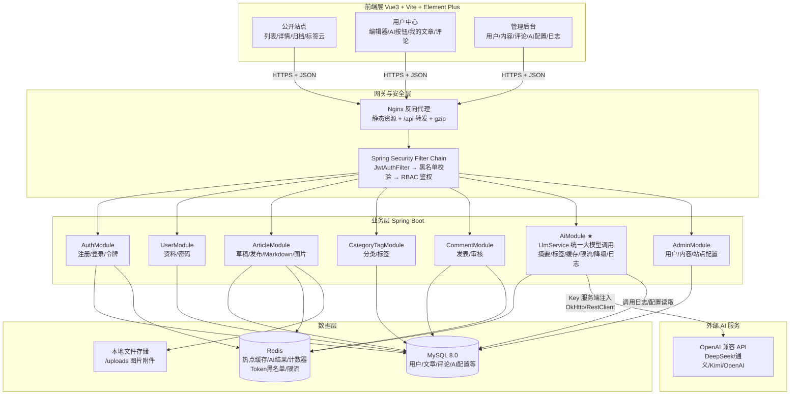
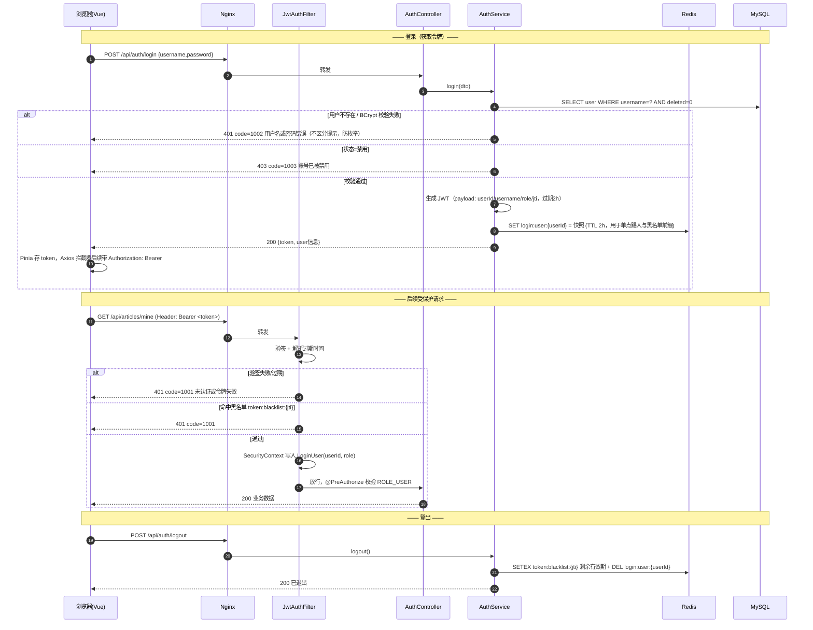
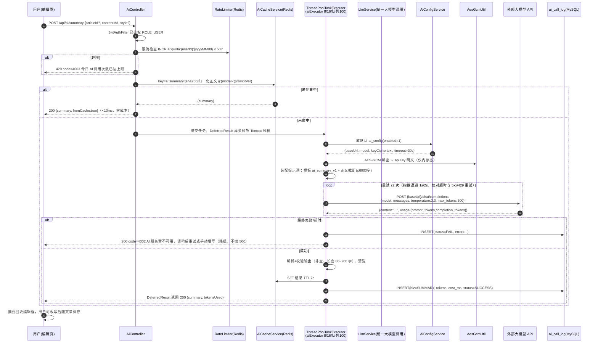

# 系统设计（个人博客系统）

> 项目：个人博客系统 ｜ v1.0 ｜ 2026-09-12 ｜ 前接《需求分析.md》，后接《数据库设计.md》《API接口设计.md》《AI模块设计.md》

## 1. 总体架构

采用**前后端分离 + 单体分层**架构（毕业设计规模下，单体是成本与复杂度最优解，边界清晰便于日后拆分）。



**分层职责约定（后端包结构）**

```
com.blog
├── common        统一响应体 Result、错误码 BizCode、全局异常、常量、工具(AES/SHA)
├── config        SecurityConfig、RedisConfig、MyBatisPlusConfig、AsyncConfig、OpenAPI
├── security      JwtAuthFilter、JwtTokenProvider、LoginUserDetails
├── module
│   ├── auth / user / article / category / tag / comment / storage / system
│   └── ai        controller / service(LlmService, AiPromptService, AiCacheService)
│                 / client(OpenAiCompatClient) / entity / mapper
└── job           PtvSyncJob(浏览量回写)、AiCostDailyJob(成本聚合)
```

调用链固定为 `Controller → Service → Mapper/Redis/Client`，Controller 不写业务，Service 不拼 SQL。

## 2. 模块划分与职责

| 模块 | 核心职责 | 关键依赖 | 详见 |
|------|----------|----------|------|
| 认证模块 auth | 注册、登录发 Token、登出拉黑、刷新 Token | Redis、user 表 | §3.1 |
| 用户模块 user | 资料查询/修改、改密、头像上传 | user 表、storage | — |
| 文章模块 article | 草稿/发布状态机、Markdown 服务端清洗、列表详情（缓存优先）、TOC | article/tag/category、Redis | §3.2 |
| 分类标签模块 category/tag | 分类 CRUD、标签 CRUD/合并、标签云聚合 | category、tag、article_tag | — |
| 评论模块 comment | 两级评论/回复、审核开关、删除 | comment、sys_config | — |
| AI 模块 ai ★ | **统一大模型调用服务**：摘要、标签、连接测试、结果缓存、限流、重试降级、调用日志、AI 配置管理（Key 加密） | ai_config、ai_call_log、Redis、线程池 | 《AI模块设计.md》 |
| 存储模块 storage | 图片/附件上传、类型与大小校验、静态映射 | file 表、本地磁盘 | — |
| 系统配置模块 system | 站点参数、评论开关、注册开关、仪表盘聚合 | sys_config | — |
| 管理后台 admin | 用户启禁、内容治理、评论审核、日志查询（复用上述模块 Service，加权限点） | 全部 | — |

**跨模块规则**：AI 模块只被文章编辑流程"建议性"调用（生成内容回填表单，由用户确认），不参与任何事务——AI 失败绝不回滚文章保存。

## 3. 核心业务流程时序图

### 3.1 登录认证流程（JWT）



### 3.2 发布文章流程（含 Markdown 处理与缓存失效）

```mermaid
sequenceDiagram
    autonumber
    participant U as 作者(编辑页)
    participant W as Vue 编辑器
    participant API as ArticleController
    participant AS as ArticleService
    participant JS as MarkdownSanitizer(jsoup)
    participant DB as MySQL
    participant R as Redis

    U->>W: 编辑 Markdown，点「图片上传」
    W->>API: POST /api/files/upload (multipart)
    API-->>W: {url:/uploads/2026/09/xxx.png} 正文插入 
    U->>W: （可选）点「AI 生成摘要」→ 见 3.3 流程 → 摘要回填输入框
    U->>W: 选择分类、勾选标签、点「发布」
    W->>API: POST /api/articles {title,categoryId,tags[],contentMd,summary,cover,status:1}
    API->>AS: saveOrUpdate(dto) @Transactional
    AS->>JS: 清洗 contentMd（白名单标签，剥离 script/iframe/on* 事件）
    JS-->>AS: 安全 HTML 片段用于提取纯文本(供AI/搜索)
    AS->>AS: 校验：标题≤200字、分类存在、标签自动补建、作者=当前用户
    alt 新建
        AS->>DB: INSERT article(status=1,published_at=now)
    else 更新
        AS->>DB: UPDATE article SET ... WHERE id=? AND user_id=?
    end
    AS->>DB: DELETE article_tag WHERE article_id=?; 批量 INSERT 关联
    AS->>R: DEL blog:article:{id}、blog:list:*（缓存主动失效）
    AS-->>API: articleId
    API-->>W: 200 {id}
    W->>U: 提示发布成功，跳转详情页
    U->>API: GET /api/articles/{id}
    API->>R: GET blog:article:{id} → MISS
    API->>DB: SELECT + 关联查询
    API->>R: SET blog:article:{id} (TTL 30min，含渲染统计字段)
    API-->>U: 200 详情（前端 markdown-it + DOMPurify 二次渲染）
```

### 3.3 AI 摘要生成流程（设计重点）



> 标签生成（`POST /api/ai/tags`）流程与 3.3 完全同构，差异仅在：提示词模板 `ai_tag_v1`、响应格式强约束为 JSON 数组（见《AI模块设计.md》§5）、后处理需做标签合法化过滤（长度、敏感词、去重、已存在标签复用 ID）。

## 4. 技术选型理由

| 选型 | 理由 | 否决的替代方案 |
|------|------|----------------|
| Vue 3 + Vite + Element Plus | 课题指定方向；Vite 冷启动/热更新快；Element Plus 的后台组件（表格、表单、树）成熟，管理端零自研组件 | React（团队与个人更熟 Vue，且生态模板多为 Vue） |
| Spring Boot 3.2 + Java 17 | 主流课设栈，Spring Security/数据访问/校验生态完整；record、switch 模式匹配简化代码 | Node.js（与"Java 软件工程方向"培养要求不符） |
| MyBatis-Plus | 单表 CRUD 零 SQL、分页插件、逻辑删除、乐观锁内置——正好匹配博客的字段级逻辑删除需求；复杂统计仍手写 XML SQL 保留可控性 | 纯 JPA（多表关联与动态统计 SQL 表达啰嗦） |
| MySQL 8.0 | 指定要求；utf8mb4 原生存 Markdown/emoji；窗口函数与 CTE 满足归档统计 | PostgreSQL（无必要） |
| Redis 7 | 一仓三用：① 热点缓存（详情/列表）② AI 结果缓存与用户配额计数 ③ Token 黑名单与登录态；`SETNX` 天然做分布式锁 | 本地 Caffeine（多实例部署时缓存不一致） |
| JWT 无状态认证 | 前后端分离标准方案；服务端不存 Session，水平扩展友好；登出问题用"jti 黑名单 + 短 TTL(2h)"补齐 | Session+Cookie（跨域配置繁琐，且无状态更贴合 REST 设计） |
| OpenAI 兼容协议对接大模型 | 一套客户端代码适配 DeepSeek/通义/Kimi/OpenAI 等全部国产与海外模型（均兼容 `/v1/chat/completions`），答辩时可现场换模型演示 | 各厂商 SDK（锁定厂商，违背"统一调用服务"的设计初衷） |
| 单体 + Docker Compose | 毕设体量下微服务是负资产；Compose 一键起 MySQL/Redis/后端/Nginx 四服务，部署演示效果好 | K8s（过度设计） |

## 5. 关键设计决策记录（ADR 摘要）

1. **AI 异步化选型：线程池 + DeferredResult，而非 MQ。** 理由：单机毕设无需 Kafka/RabbitMQ 运维成本；AI 请求是"请求-响应"语义，用户在页面等待结果，MQ 的解耦收益用不上；`ThreadPoolTaskExecutor` + `DeferredResult` 已能保护 Tomcat 线程（超时 35s 主动返回降级）。演进预案：若将来改为"批量为全站旧文章生成摘要"，再引入 MQ 做离线任务。
2. **AI Key 加密：AES-256-GCM，主密钥来自环境变量。** 不引入 Vault（过度），但主密钥与密文分离存储，DB 泄露 ≠ Key 泄露；每次加密使用随机 IV，密文 = IV+Tag+Data 的 Base64。
3. **缓存失效策略：写后删除（Cache-Aside + DEL）而非更新。** 文章发布/编辑后只 `DEL`，读时回填——避免并发读写下的"旧值覆盖"竞态；列表类缓存用通配删除（键规范 `blog:list:{hash}` 集合登记）或短 TTL（5min）兜底。
4. **浏览量异步计数**：`INCR` Redis + 定时任务每 5min 回写，写 QPS 与读 QPS 解耦。
5. **图片存本地磁盘而非 OSS**：范围排除项；`file` 表预留 `storage_type` 字段，后期可平移到 OSS。
