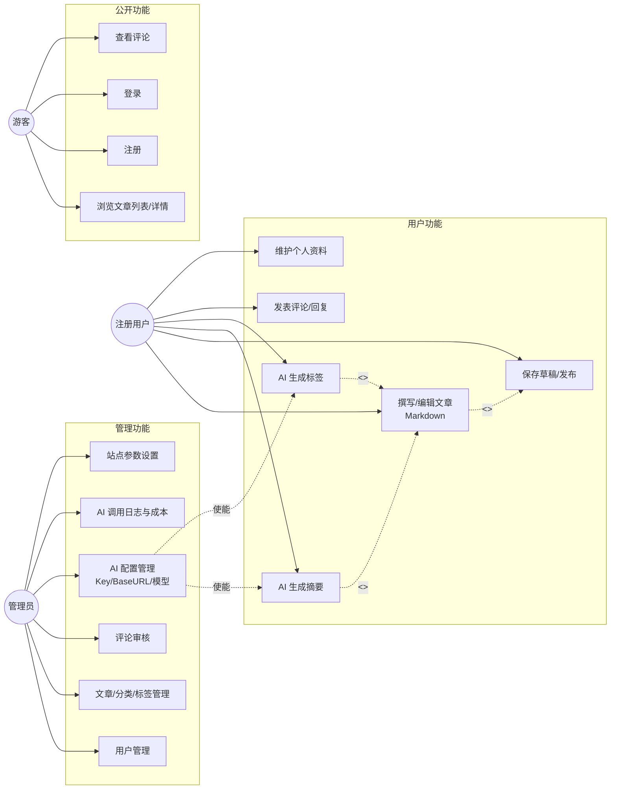

# 需求分析（个人博客系统）

> 项目：个人博客系统 ｜ 技术栈：Vue 3 + Spring Boot + MySQL + Redis + JWT + AI ｜ v1.0 ｜ 2026-09-12

## 1. 概述

### 1.1 系统目标

构建一个支持多用户注册的个人博客平台：读者可浏览、检索、评论；注册用户可作为作者使用 Markdown 撰写、发布、管理自己的文章，并借助 AI 一键生成摘要与标签；管理员统一管理用户、内容、站点配置以及**大模型 API 配置**（Key/Base URL/模型名），所有 AI 调用由后端统一代理完成。

### 1.2 用户角色定义

| 角色 | 标识 | 说明 |
|------|------|------|
| 游客 | `anonymous` | 未登录访问者，只读公开内容 |
| 注册用户 | `ROLE_USER` | 已登录的读者兼作者，可管理"自己的"内容与互动 |
| 管理员 | `ROLE_ADMIN` | 平台运营者，拥有全站管理权与 AI 配置权 |

> 角色权限模型采用 RBAC（用户—角色—权限三层），本期固定两种内置角色，权限点按"模块:操作"命名（如 `article:save`、`ai:config`），为后续扩展编辑/审核员角色预留空间。

## 2. 功能性需求（角色-用例方式）

### 2.1 游客用例

| 用例编号 | 用例名称 | 描述 | 优先级 |
|----------|----------|------|--------|
| UC-V-01 | 浏览文章列表 | 分页浏览已发布文章，支持按分类、标签、关键词筛选，按时间/热度排序 | P0 |
| UC-V-02 | 查看文章详情 | 阅读 Markdown 渲染后的正文，展示摘要、标签、作者、浏览量、目录 TOC | P0 |
| UC-V-03 | 查看文章评论 | 浏览已通过审核的评论（两级：评论 + 回复） | P1 |
| UC-V-04 | 注册账号 | 用户名 + 密码 + 邮箱注册，用户名/邮箱唯一性校验 | P0 |
| UC-V-05 | 登录 | 账号密码登录，成功后获得 JWT | P0 |
| UC-V-06 | 归档与云视图 | 按年/月归档浏览、分类导航、标签云 | P2 |

### 2.2 注册用户用例

| 用例编号 | 用例名称 | 描述 | 优先级 |
|----------|----------|------|--------|
| UC-U-01 | 退出登录 | 注销当前 JWT，服务端将该 Token 加入 Redis 黑名单 | P0 |
| UC-U-02 | 维护个人资料 | 修改昵称、头像（上传图片）、个人简介、邮箱 | P1 |
| UC-U-03 | 修改密码 | 校验旧密码后更新（BCrypt 重散列），并使旧 Token 失效 | P1 |
| UC-U-04 | 撰写文章 | Markdown 编辑器撰写正文，支持图片上传插入、封面图、选择分类、输入标签 | P0 |
| UC-U-05 | ★AI 生成摘要 | 在编辑页一键调用大模型，根据正文生成 80~150 字中文摘要，可重新生成、可手动改写 | P0 |
| UC-U-06 | ★AI 生成标签 | 一键生成 3~6 个候选标签（JSON 数组），可勾选/增删后确认写入 | P0 |
| UC-U-07 | 保存草稿 | 文章可存为草稿（status=0），仅作者可见 | P0 |
| UC-U-08 | 发布/下线文章 | 草稿发布为正式文章；已发布文章可撤回为草稿 | P0 |
| UC-U-09 | 编辑/删除自己的文章 | 修改任意字段；删除为逻辑删除，管理员可在回收站彻底删除 | P0 |
| UC-U-10 | 发表评论 | 对已允许评论的文章发表评论，支持对某条评论回复（限两级） | P1 |
| UC-U-11 | 删除自己的评论 | 逻辑删除 | P1 |
| UC-U-12 | 查看"我的"列表 | 我的文章（按状态筛选）、我的草稿、我的评论 | P1 |
| UC-U-13 | 点赞文章 | 对文章点赞/取消点赞，Redis 计数、定时回写 MySQL | P2 |

### 2.3 管理员用例

| 用例编号 | 用例名称 | 描述 | 优先级 |
|----------|----------|------|--------|
| UC-A-01 | 用户管理 | 分页检索用户，启用/禁用账号（禁用即刻踢下线），分配角色 | P0 |
| UC-A-02 | 文章管理 | 跨用户检索全站文章，强制下线/删除/置顶任意文章 | P0 |
| UC-A-03 | 分类管理 | 分类的增删改查与排序；分类下仍有文章时禁止删除 | P1 |
| UC-A-04 | 标签管理 | 标签增删改查、合并标签 | P1 |
| UC-A-05 | 评论管理 | 全站评论列表，审核（待审/通过/屏蔽）、删除违规评论 | P1 |
| UC-A-06 | ★AI 配置管理 | 新增/编辑/停用大模型 API 配置：名称、厂商、Base URL、API Key（写后不可读明文，仅显示掩码 `sk-****abcd`）、模型名、temperature、max_tokens、超时、是否默认。支持"连接测试"按钮验证可用性 | P0 |
| UC-A-07 | ★AI 调用日志 | 查看每次调用的业务类型、模型、Token 用量、耗时、成功/失败、缓存命中标记；按日聚合成本统计 | P0 |
| UC-A-08 | ★AI 配额设置 | 按用户/全局设置每日 AI 调用次数上限与全站日预算阈值（写入 sys_config） | P1 |
| UC-A-09 | 站点参数设置 | 站点名称、Logo、备案号、是否开放注册、评论是否先审后发 | P1 |
| UC-A-10 | 数据仪表盘 | 文章数、用户数、评论数、7 日访问趋势（ECharts 图表） | P2 |

### 2.4 用例图（Mermaid）

> 说明：图中"使能"关系是本系统的核心语义——管理员的 AI 配置（UC-A-06）是用户 AI 用例（UC-U-05/06）的前置条件；无可用默认配置时，用户端 AI 按钮置灰并提示"管理员尚未配置模型服务"。

## 3. 非功能性需求

| 编号 | 类别 | 需求描述 | 度量/验收方式 |
|------|------|----------|----------------|
| NFR-01 | 性能 | 文章列表/详情等缓存命中接口 P95 < 300ms，未命中 < 800ms；单实例支撑 ≥ 200 并发读 | JMeter 压测报告 |
| NFR-02 | AI 时延 | AI 摘要/标签接口 95% 在 15s 内返回；超时不阻塞 Tomcat 工作线程（异步 + 线程池） | 压测 + 日志 |
| NFR-03 | 安全-认证 | 密码 BCrypt 加盐散列；JWT 有效期 2h + Redis 黑名单注销；管理接口强制 `ROLE_ADMIN` | 代码审查 + 越权测试 |
| NFR-04 | 安全-Key | API Key 以 AES-256-GCM 密文入库，任何查询接口只返回掩码；主密钥仅存于环境变量 | 数据库抽查 + 接口返回审查 |
| NFR-05 | 安全-XSS | Markdown 渲染前后双重过滤（后端 jsoup 清洗 + 前端 DOMPurify）；评论纯文本转义 | 注入用例测试 |
| NFR-06 | 可靠性 | 大模型调用失败自动重试 ≤2 次；仍失败则降级返回业务错误码 4002，绝不导致文章保存失败 | 故障演练（改错 Key） |
| NFR-07 | 可用性 | 单机 Docker Compose 部署可用性 ≥ 99%（毕业设计规模）；MySQL 每日 mysqldump 备份 | 部署文档验证 |
| NFR-08 | 可维护性 | 分层架构 + 统一响应体 + 全局异常处理；核心 Service 单测覆盖率 ≥ 60%；Knife4j 在线文档 | 覆盖率报告 |
| NFR-09 | 兼容性 | Chrome / Edge / Firefox 最新两个大版本；后台适配 ≥1280px 宽度 | 人工回归 |
| NFR-10 | 成本可控 | AI 调用全量记账（Token/耗时/预估费用），可按日/用户聚合；超预算可一键停用 AI 功能 | 日志表核对 |

## 4. 需求优先级汇总（MoSCoW）

| 级别 | 含义 | 需求项 |
|------|------|--------|
| P0 Must | 无则系统不成立 | UC-V-01/02/04/05、UC-U-01/04/05/06/07/08/09、UC-A-01/02/06/07、NFR-01/03/04/05/06 |
| P1 Should | 第一版应交付 | UC-V-03、UC-U-02/03/10/11/12、UC-A-03/04/05/08/09、NFR-02/07/08 |
| P2 Could | 时间富余再做 | UC-V-06、UC-U-13、UC-A-10、NFR-09/10（NFR-10 的"记账"部分属 P0，"预算熔断"属 P2） |
| Won't | 本期明确不做 | 多语言站点、付费专栏、RSS 推送、SEO 深度优化、对象存储 OSS、微服务拆分（详见《项目计划.md》范围排除项） |

## 5. 关键业务规则

1. 文章状态机：`草稿(0) → 已发布(1) ⇄ 下线(2)`，任意状态可 `逻辑删除(3)`；仅"已发布"对外可见。
2. 浏览量：Redis `INCR blog:pv:{articleId}`，每 5 分钟或达阈值回写 MySQL，避免每读一次写一次库。
3. 评论审核：由 `sys_config.comment_audit` 开关决定是否"先审后发"；被禁言用户的评论直接拒绝。
4. AI 生成结果均为**建议值**，必须用户确认后才写入文章，不自动保存。
5. 相同正文（SHA-256 归一化哈希）+ 相同模型 + 相同提示词版本 的 AI 请求直接命中 Redis 缓存，不重复计费。
6. 游客与无 `ai:use` 权限者不可调用 AI 接口；每用户每日 AI 调用上限默认 50 次（sys_config 可调）。
